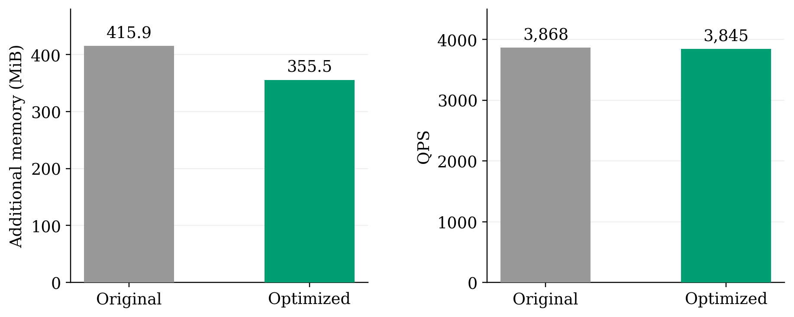

# Compact NMD memory and adapter validation

This change is shared by native NeighborCache, Starling, MARGO, PipeANN and
AiSAQ. The four hosts load `neighborcache_backend`, which compiles the actual
`diskann/src/pq_flash_index.cpp` and cache headers. No host patch needs a second
implementation of the new directory, packing, zero-tail storage or sampling.

Private prefetch demand lookup uses only the calling worker's record directory.
N remains shared. On a base/D admission, a parent-seed index checks only that
worker's resident path-parent page for an update; it does not restrict demand
lookup. Dynamic pages are created/updated in prefetch and written to D through
asynchronous dirty eviction. Obsolete direct D commits are bypassed. Each worker
can admit its own seed replica even when another worker owns the same seed.
Immutable record snapshots remain usable after a different worker repacks the
shared D slot; stale generations cannot overwrite the current D image.

## Saved performance measurement

`comparison.json`, `comparison.csv` and `benchmark_runs.json` preserve the
earlier isolated-build measurements; `measured_configuration.json` is the exact
local command/environment. These are measured data, not values regenerated from
the integration checks below.

| Metric, mean of two runs | Control | Selected compact configuration |
|---|---:|---:|
| Additional RSS, MiB | 415.87 | 355.50 |
| QPS | 3,868.00 | 3,844.94 |
| N hits / all node accesses | 13.895% | 14.005% |
| Prefetch hits / all node accesses | 5.013% | 5.017% |
| Disk requests / query | 117.810 | 117.642 |

The observed saving is 60.375 MiB (14.52%); QPS changes by -0.60%. These two
runs do not establish a stable speedup. Prefetch hit rate was preserved. The
logical page count, neighbor membership and seed admission rule were retained.
The selected run uses both zero-tail storage and an explicitly smaller
8 MiB D-location accelerator; the default automatic accelerator size is unchanged.

Configuration:

- SIFT100M, 10K uniform + 10K corresponding Zipf queries, shuffled; 20K total.
- uint8 L2, K=10, L=128, beam=4; 20 query workers on CPUs 0-19; background
  workers on CPUs 20-23. Static round-robin query scheduling.
- N=42,474 nodes; M=131,072 entries; prefetch=51,200 logical 4 KiB pages total,
  2,560 pages / 10 MiB maximum raw payload per worker, retained across queries.
- D=65,536 SSD pages (256 MiB), at most one page per seed. N/P/D start cold;
  no prefill. Node heat sampling is 1/10, before M-cache decision/locking.
- `NEIGHBORCACHE_CANON_SLOTS=1048576`,
  `NEIGHBORCACHE_PREFETCH_TRIM_ZERO_TAIL=1`, M lookup bitmap off.
- Additional RSS is `after_search - after_load`, including auxiliary cache
  structures and allocator effects; common PQ/index loading is excluded. SSD D
  payload is not counted as RAM. Logical N/P capacities are not RSS budgets.

File caches were cleared and checked before every run. Each run then performed
the same independent 7,729,176,576-byte random-read conditioning stream before
timing queries; it did not execute queries or populate N/M/P/D. This is not a
fully cold-device latency measurement. The archived isolated app includes
`NC_AUDIT_PRECONDITION_TRACE`/stage-probe hooks that are not CLI features of the
normal repository executable. Profiling was enabled in both measured variants.
The exact query source, isolated binary and raw logs remain under
`/mnt/nvme2/nc_zero_tail_20261031/`. All result IDs and distances in these native
runs matched the saved DiskANN+BFS output byte for byte.



## Current-source validation

`validation.json` saves the clean-build test reports. `adapter_validation.json`
contains every host's actual counters; `validation_commands/` saves the binary
and backend hashes and local commands. The test library was built directly
from the source in this change, rather than reusing an old instrumented library.

- Common backend: 25/25 CTests, including static/grouped prefetch expansion,
  three concurrent record layouts, thread isolation, byte reconstruction,
  duplicate record locations, LRU eviction, snapshots and AIO interruption.
- Native: 11/11 targeted CTests, including the canonical-directory tombstone
  regression, owned N snapshots, direct record packing, optional M bitmap and
  actual asynchronous writer behavior in shared/private modes.
- Starling, MARGO and PipeANN: SIFT10M, 20 query workers. AiSAQ: SIFT100K,
  8 workers. Each host ran 5,000 queries with trim off and another 5,000 with
  trim on. Every cache-hit record was checked bytewise against its original
  index. All eight runs exercised prefetch hits, D reads and completed writes.
- These correctness checks use N=1,024 nodes, M=2,048 entries, D=512 pages,
  **one prefetch page per worker** to force eviction, no prefill/query reset,
  maintenance enabled and background writer/commit threads on CPUs 20-23.
  This pressure-test size is not the performance configuration above.

Verification performs extra original-index reads and its timings must not be
reported as QPS. Record equality does not prove unchanged recall/search results
for asynchronous or page-expansion hosts. No new host-wide speedup or equal-recall
claim is made. The earlier ASan/UBSan checks of zero-tail roundtrips and randomized
record directories are recorded in `comparison.json`.

Build the common backend and run its tests:

```sh
cmake -S neighborcache_backend -B neighborcache_backend/build -DCMAKE_BUILD_TYPE=Release
cmake --build neighborcache_backend/build -j 4
ctest --test-dir neighborcache_backend/build --output-on-failure
export NEIGHBORCACHE_BACKEND_LIBRARY="$PWD/neighborcache_backend/build/libneighborcache_backend.so"
export NEIGHBORCACHE_PREFETCH_THREAD_PRIVATE=1
```

Native regression targets require `-DUNIT_TEST=ON`. This machine also needs
`MKL_PATH`, `MKL_INCLUDE_PATH` and `OMP_PATH` pointing to the Conda libraries,
and `-DCMAKE_EXE_LINKER_FLAGS='-Wl,--no-as-needed -latomic'` for its MKL build.
See the backend README for local include/library paths.

Repeat the host record checks using command manifests with local paths:

```sh
python experiments/neighborcache_alignment/compact_memory/verify_adapters.py \
  --commands /mnt/nvme2/nc_shared_backend_20261027/final \
  --backend "$NEIGHBORCACHE_BACKEND_LIBRARY" \
  --output /mnt/nvme2/compact_adapter_check_new
```

The output directory must be new; existing measurements are never overwritten.
ABI 2 is unchanged. Existing ABI-2 hosts can load the rebuilt library without
recompiling their search code; rebuild native DiskANN for its compiled-in cache.
